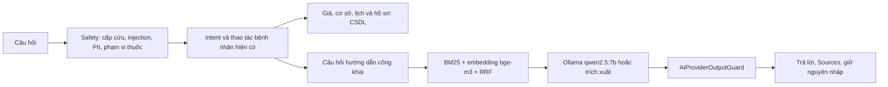

# Hỏi đáp tài liệu phòng khám với Ollama cục bộ

## Luồng xử lý



`AiSpecialtyService.cs` chỉ thêm dependency và lời gọi ngay trước nhánh 3.1. Logic mới nằm trong `AiSpecialtyService.Knowledge.cs` và thư mục `AI/Knowledge`. Safety và bộ kiểm tra dữ liệu cá nhân chạy trước. Các thao tác đọc dữ liệu bệnh nhân, hủy/đổi lịch hiện có vẫn có quyền ưu tiên. Giá và thông tin cơ sở tiếp tục lấy từ handler CSDL, không đi RAG. Câu mô tả triệu chứng và intent thao tác tường minh giữ luồng hiện tại. Bộ phát hiện RAG yêu cầu cụm hỏi hướng dẫn; các câu ngắn như “huy lich” và yêu cầu trộn đặt/xem lịch vẫn được hỏi lại theo hành vi cũ.

## Truy xuất và dữ liệu gửi mô hình

- Tài liệu Markdown có front matter `id`, `title`, `category`, `updated`; chia theo heading, tối đa 550 ký tự, overlap khoảng 50 ký tự ở phần dài. Đoạn cuối có thể ngắn hơn 300 ký tự. Mỗi đoạn giữ nguồn và mã riêng.
- BM25 chạy cục bộ trong mọi cấu hình: chữ thường, bỏ dấu câu, token có dấu và bỏ dấu, thêm bigram. Điểm chuẩn hóa `raw / (raw + 5)`, ngưỡng mặc định 0,35. Có bộ lọc chủ đề công khai trước truy xuất để giảm trả lời ngoài phạm vi.
- Khi RAG bật, worker dựng embedding bge-m3 ở background theo lô hai đoạn, công bố nguyên index sau khi kiểm tra đủ vector hữu hạn, cùng chiều, khác vector không. CSDL không tham gia dựng index. Lexical retrieval dùng được trong lúc chờ.
- Embedding truy vấn dùng câu hỏi chuẩn từ danh mục cụm từ phía server. Không đưa nguyên văn người dùng, tuổi, tên, mã hồ sơ, lịch sử hội thoại, nháp, dữ liệu tool hay thông tin tài khoản vào embedding hoặc chat. Ví dụ câu hỏi có tên người kèm “nhịn ăn” chỉ trở thành câu hướng dẫn công khai về chuẩn bị xét nghiệm.
- RRF dùng `sum(1 / (60 + rank))`, rank bắt đầu từ 1, top-k mặc định 4. Dense ranking với cosine ≥ 0,55 chỉ xếp lại các đoạn đã vượt ngưỡng lexical. Đây là lựa chọn thận trọng: embedding không tự mở rộng sang tài liệu không có bằng chứng lexical. Điểm RRF dùng xếp hạng; ngưỡng được áp trên bằng chứng trước fusion.
- Cache tại `App_Data/rag/<SHA256>.json`, đã được `.gitignore` của repo loại trừ. Hash gồm phiên bản index, tên embedding model và nội dung có thứ tự. Cache hỏng sẽ dựng lại; không ghi được cache vẫn dùng index RAM. Tắt ứng dụng rồi thay model/tag bằng nội dung khác thì nên xóa cache tương ứng vì tag Ollama có thể đổi nội dung.

## Sinh câu trả lời và khi Ollama lỗi

Gọi `/api/chat` với `stream=false`, temperature 0,1, giới hạn token và tối đa năm câu ở đầu ra. System prompt yêu cầu chỉ dựa tài liệu, không chẩn đoán/kê thuốc, thiếu thông tin thì hướng dẫn liên hệ lễ tân. Prompt chỉ chứa câu hỏi công khai chuẩn hóa và bốn đoạn tài liệu. Mọi câu trả lời, kể cả trích xuất, đều qua `AiProviderOutputGuard`; bị chặn dùng thông báo, mã lỗi và hành động cấp cứu giống nhánh provider hiện tại.

RAG tắt, HTTP lỗi, nội dung JSON sai, model chưa có, timeout hoặc circuit mở: dùng đoạn tốt nhất, cắt gọn và trích đúng nguồn đoạn đó. Circuit độc lập với Gemini, dùng cơ chế `AiProviderHealth`: mở sau một lỗi, nghỉ 30 giây, chỉ một probe khi half-open. Health check `/api/tags` giới hạn hai giây; worker không chặn khởi động. Request HTTP không dùng proxy và chỉ cho phép HTTP loopback. Với host `localhost`, dùng IPv4 `127.0.0.1` để tránh độ trễ IPv6 khi Ollama Windows chỉ nghe IPv4.

`KnowledgeAnswer` nghĩa là dùng đầu ra chat Ollama; `KnowledgeExtractive` là trích xuất. `ProviderWasCalled` tính cả request embedding truy vấn/chat thực sự gửi đi; khi circuit chặn hoặc RAG tắt thì false. `ExecutionMode` là `ProviderAssisted` khi sinh, `DeterministicFallback` khi trích xuất, `ManualHandoff` khi output guard chặn. Embedding dựng index nền không được tính vào từng lượt chat. Nguồn của đầu ra sinh là các đoạn cung cấp cho mô hình, không phải bằng chứng kiểm định từng mệnh đề do mô hình sinh.

API thêm `Sources: [{docId,title,heading}]`. Vì hook `useAiBookingFlow.ts` thuộc vùng chưa được mở khóa, backend đồng thời chuyển cùng metadata công khai qua `toolResults/resultType=knowledge_sources` mà hook đã vận chuyển sẵn. `MedicalChatWidgetSources` hiển thị bằng `Typography.Text type="secondary"`, hỗ trợ cả trường Sources trực tiếp và metadata này. Không đổi logic hay quyền đăng nhập của widget.

## Thêm tài liệu

1. Thêm `.md` trong `src/backend/ClinicManagement.Infrastructure/AI/Knowledge/Documents`, đặt id duy nhất, cập nhật ngày và heading có nghĩa. Tài liệu được copy cả khi build và publish.
2. Đối chiếu hành vi với service thật. Không viết giá, địa chỉ, điện thoại, giờ làm việc, nội dung chẩn đoán hoặc liều thuốc. Giá/cơ sở chỉ dẫn người dùng tới trang tương ứng.
3. Bổ sung cụm chủ đề công khai trong `KnowledgeQuestionPolicy` khi có chủ đề mới; không dùng nguyên văn người dùng làm prompt thay cho bước chuẩn hóa.
4. Thêm câu hỏi phát triển và test mới; chạy đánh giá và test output guard trên toàn bộ đoạn. Build và khởi động lại để nạp corpus mới. Hash mới tự tạo cache embedding mới.

Đối chiếu nghiệp vụ: `ConfirmedAppointmentExpiryRule` và `docs/expiry-rules.md` (30 phút, tác vụ nền, hạn yêu cầu và vắng mặt); `ChangeRequestService` (đổi/hủy chờ xử lý); `DiagnosticResultPublicationPolicy`/`DiagnosticWorkflowService` (công bố sau duyệt); `PharmacyService`/`PrescriptionPaymentEligibilityService` (điều kiện lĩnh thuốc); `BillingService` và trang `PatientInvoices` (thu tại quầy); `Login`/`ForgotPasswordModal` và `AuthenticationService` (khôi phục mật khẩu).

Các đoạn chuẩn bị xét nghiệm chỉ hướng dẫn hỏi nơi thực hiện, không ấn định thời gian nhịn ăn. Tham chiếu thông tin chuẩn bị chung: [NHS: blood tests](https://www.nhs.uk/tests-and-treatments/blood-tests/) và [NHS: X-ray](https://www.nhs.uk/tests-and-treatments/x-ray/). API Ollama: [tài liệu chính thức](https://github.com/ollama/ollama/blob/main/docs/api.md).

## Bật/tắt và đánh giá

```powershell
ollama serve
ollama pull qwen2.5:7b
ollama pull bge-m3
dotnet run --project src/backend/ClinicManagement.Api --launch-profile http
dotnet run --project src/tools/ClinicManagement.AI.RagEval -- bm25
dotnet run --project src/tools/ClinicManagement.AI.RagEval -- hybrid
```

`Rag:IsEnabled=false` trong appsettings mặc định và Testing; Development bật. Các tùy chọn: `BaseUrl`, `ChatModel`, `EmbeddingModel`, `TimeoutSeconds` (45, giới hạn 1–120), `MinScore` (0,35), `TopK` (4). Có thể ghi đè bằng biến môi trường `Rag__IsEnabled=false`. Gemini/provider/planner hiện có không bị sửa và vẫn tắt theo cấu hình Development. Tool đánh giá không gọi chat, không cần tài khoản bệnh nhân và không chạy trong CI. Hybrid đòi hỏi đủ index và embedding truy vấn thành công; lỗi sẽ dừng thay vì báo số BM25 thành hybrid.

Giới hạn quyền hiện tại: endpoint `/api/v1/ai/chat` yêu cầu Patient, khách nhận HTTP 401; widget khách chỉ có thông báo đăng nhập. Phạm vi sửa widget của yêu cầu này chỉ mở hiển thị nguồn, nên chưa mở chat công khai cho khách. Việc mở quyền khách cần một thay đổi được phép riêng, kèm kiểm thử hợp đồng bảo mật hiện có.
