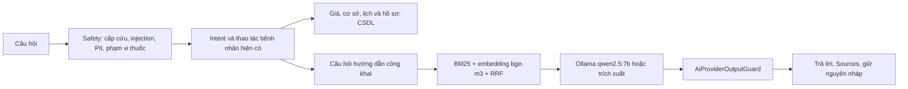

# Hỏi đáp tài liệu phòng khám với Ollama cục bộ

## Luồng xử lý



`AiSpecialtyService.cs` chỉ nối hai thời điểm gọi RAG; phần phát hiện nằm trong `AiSpecialtyService.Knowledge.cs` và `AI/Knowledge`. Diff caller là ba dòng thêm/ba dòng thay, không tăng số dòng. Safety, phạm vi thuốc và bộ kiểm tra dữ liệu cá nhân vẫn chạy trước.

RAG sớm thử câu hướng dẫn chung có “hướng dẫn”, “cách”, “như thế nào”, “thế nào”, “quy trình”, “thủ tục”, “phải làm gì” hoặc câu hỏi điều hướng giao diện: `o muc nao`, `muc nao`, `o dau tren web`, `tren web`, `tren website`, `menu`, `trang nao`, `bam vao dau`, `vao dau de` sau chuẩn hóa. Cùng nhận diện điều hướng được dùng tại `IsCandidate` để câu không có dấu hỏi vẫn vượt cổng và không bị coi là yêu cầu đọc dữ liệu chỉ vì classifier nhận DiagnosticLookup/PrescriptionLookup. Điều kiện RAG sớm vẫn loại từ sở hữu dữ liệu cá nhân, “mã”, “số”, chuyên khoa được nhận diện, bác sĩ, ngày/giờ hoặc chỉ số lựa chọn. Vì vậy “xem kết quả xét nghiệm ở mục nào trên web” được hỏi đáp tài liệu trước handler đọc, còn “xem kết quả xét nghiệm của tôi”, “đơn thuốc của tôi” và các biến thể sở hữu có “trên web” vẫn qua nhánh dữ liệu cũ. Không sửa `AiSpecialtyService.PatientReadFilters.cs` hoặc caller; safety và intent tường minh giữ kiểm tra cũ. Những câu khác giữ thứ tự đọc dữ liệu trước, RAG sau; cùng một câu không truy xuất RAG hai lần.

Cổng `IsCandidate` nhận câu hỏi chưa rõ intent, hoặc hướng dẫn chung về thao tác khi không có lựa chọn cụ thể. Intent rõ về thao tác không trở thành RAG chỉ vì có “được không”. Nhận cả dấu hỏi, cách hỏi không dấu và viết tắt như “ko”, “k”, “sao”, “ở đâu”. Từ không dấu “ho”, “dau”, “non” chỉ coi là triệu chứng trong cụm rõ, tránh nhầm “hồ sơ” và “ở đâu”; dấu hiệu cấp cứu vẫn thắng mọi tuyến. Giá/giờ làm việc/địa chỉ/điện thoại của cơ sở tiếp tục lấy từ CSDL; các câu “ở đâu” về quy trình không bị ép thành tra cứu cơ sở. “huy lich” ngắn và yêu cầu trộn đặt/xem lịch vẫn theo luồng hỏi lại cũ.

## Truy xuất và dữ liệu gửi mô hình

- Tài liệu Markdown có front matter `id`, `title`, `category`, `updated`; chia theo heading, tối đa 550 ký tự, overlap khoảng 50 ký tự ở phần dài. Đoạn cuối có thể ngắn hơn 300 ký tự. Mỗi đoạn giữ nguồn và mã riêng.
- BM25 chạy cục bộ trong mọi cấu hình: chữ thường, bỏ dấu câu, token có dấu và bỏ dấu, thêm bigram. Điểm chuẩn hóa `raw / (raw + 5)`, `MinScore=0,45`. Không có Topics hay danh sách chủ đề bắt buộc. Hit đứng đầu còn phải đạt `MinQueryCoverage=0,5` trên các từ nội dung và có từ khớp với IDF ít nhất `MinTermIdf=1,25`; đây là cơ chế chủ yếu từ chối câu ngoài phạm vi.
- Khi RAG bật, worker dựng embedding bge-m3 ở background theo lô hai đoạn, công bố nguyên index sau khi kiểm tra đủ vector hữu hạn, cùng chiều, khác vector không. CSDL không tham gia dựng index. Lexical retrieval dùng được trong lúc chờ.
- `KnowledgePrivacyMask` giữ nội dung câu hỏi thật, che email, số điện thoại, dãy từ chín chữ số (kể cả cách bằng dấu cách/chấm/gạch), mã lịch/hồ sơ theo prefix hoặc ngữ cảnh, phần tên sau lời giới thiệu và tuổi đi kèm. Phép che lặp lại không làm thay đổi câu đã che. Regex hết thời gian thì trả rỗng và không gọi mô hình. Ví dụ phần “nhịn ăn bao lâu trước khi lấy máu?” được giữ nguyên thay vì đổi thành nhãn chủ đề.
- Cùng một câu đã che được dùng cho BM25, query embedding và `/api/chat`. Không truyền lịch sử hội thoại, nháp, hồ sơ, dữ liệu tool hay thông tin tài khoản. Hàm PublicQuestion và cơ chế thay câu hỏi bằng nhãn chủ đề đã bị loại khỏi đường gửi mô hình. Bộ che là quy tắc định dạng, không phải hệ thống nhận diện mọi loại PII tự do; màn hình chat vẫn giữ cảnh báo không nhập thông tin riêng tư.
- RRF dùng `sum(1 / (60 + rank))`, rank bắt đầu từ 1, top-k mặc định 4. Dense ranking với cosine ≥ 0,55 chỉ xếp lại các đoạn đã vượt ngưỡng lexical. Đây là lựa chọn thận trọng: embedding không tự mở rộng sang tài liệu không có bằng chứng lexical. Điểm RRF dùng xếp hạng; ngưỡng được áp trên bằng chứng trước fusion.
- `MinCosine=0,2` kiểm tra hit đứng đầu khi có index embedding; mức này gần như không lọc trên bộ dev hiện tại. Việc từ chối ngoài phạm vi chủ yếu đến từ độ phủ từ khóa BM25 (`MinQueryCoverage` + `MinTermIdf`), không thể quy thành tác dụng của cosine. Sàn này khác ngưỡng dense ranking `max(0,55, MinCosine)` trong RRF. Không thay giá trị `MinCosine` trong lần nâng cấp nội dung.
- Cache tại `App_Data/rag/<SHA256>.json`, đã được `.gitignore` của repo loại trừ. Hash gồm phiên bản index, tên embedding model và nội dung có thứ tự. Cache hỏng sẽ dựng lại; không ghi được cache vẫn dùng index RAM. Tắt ứng dụng rồi thay model/tag bằng nội dung khác thì nên xóa cache tương ứng vì tag Ollama có thể đổi nội dung.

## Sinh câu trả lời và khi Ollama lỗi

Gọi `/api/chat` với `stream=false`, temperature 0,1, giới hạn token và tối đa năm câu ở đầu ra. System prompt yêu cầu chỉ dựa tài liệu, không chẩn đoán/kê thuốc, thiếu thông tin thì hướng dẫn liên hệ lễ tân. Prompt chỉ chứa câu hỏi thật đã che và các đoạn có nguồn được chọn: điểm ≥60% điểm hit đầu, tối đa hai nguồn khác nhau theo docId + heading. Chỉ các đoạn này được cấp cho chat model; Sources không liệt kê những đoạn đã loại. Trích xuất vẫn chỉ dùng nguồn đoạn tốt nhất. Mọi câu trả lời, kể cả trích xuất, đều qua `AiProviderOutputGuard`; bị chặn dùng thông báo, mã lỗi và hành động cấp cứu giống nhánh provider hiện tại.

Khi RAG bật, sau khi index embedding sẵn sàng, background worker gọi `/api/chat` với messages rỗng để nạp chat model, `keep_alive="30m"`. Warm-up không chặn API khởi động, không chứa câu hỏi/hồ sơ bệnh nhân; thất bại chỉ ghi warning và giữ khả năng trích xuất. Chat và embed đều dùng keep_alive 30 phút; warm-up và dựng index nền không tính vào ProviderWasCalled của lượt chat.

RAG tắt, HTTP lỗi, nội dung JSON sai, model chưa có, timeout hoặc circuit mở: dùng đoạn tốt nhất, cắt gọn và trích đúng nguồn đoạn đó. Circuit độc lập với Gemini, dùng cơ chế `AiProviderHealth`: mở sau một lỗi, nghỉ 30 giây, chỉ một probe khi half-open. Health check `/api/tags` giới hạn hai giây; worker không chặn khởi động. Request HTTP không dùng proxy và chỉ cho phép HTTP loopback. Với host `localhost`, dùng IPv4 `127.0.0.1` để tránh độ trễ IPv6 khi Ollama Windows chỉ nghe IPv4.

`KnowledgeAnswer` nghĩa là dùng đầu ra chat Ollama; `KnowledgeExtractive` là trích xuất. `ProviderWasCalled` tính cả request embedding truy vấn/chat thực sự gửi đi; khi circuit chặn hoặc RAG tắt thì false. `ExecutionMode` là `ProviderAssisted` khi sinh, `DeterministicFallback` khi trích xuất, `ManualHandoff` khi output guard chặn. Embedding dựng index nền không được tính vào từng lượt chat. Nguồn của đầu ra sinh là các đoạn cung cấp cho mô hình, không phải bằng chứng kiểm định từng mệnh đề do mô hình sinh.

API thêm `Sources: [{docId,title,heading}]`. Vì hook `useAiBookingFlow.ts` thuộc vùng chưa được mở khóa, backend đồng thời chuyển cùng metadata công khai qua `toolResults/resultType=knowledge_sources` mà hook đã vận chuyển sẵn. `MedicalChatWidgetSources` hiển thị bằng `Typography.Text type="secondary"`, hỗ trợ cả trường Sources trực tiếp và metadata này. Không đổi logic hay quyền đăng nhập của widget.

## Thêm tài liệu

1. Thêm `.md` trong `src/backend/ClinicManagement.Infrastructure/AI/Knowledge/Documents`, đặt id duy nhất, cập nhật ngày và heading có nghĩa. Tài liệu được copy cả khi build và publish.
2. Đối chiếu hành vi với service thật. Không viết giá, địa chỉ, điện thoại, giờ làm việc, nội dung chẩn đoán hoặc liều thuốc. Giá/cơ sở chỉ dẫn người dùng tới trang tương ứng.
3. Không cần đăng ký Topics. Chạy bộ phát triển để kiểm tra điểm BM25 và bảo đảm câu hỏi thật được che định danh trước khi gửi mô hình; không thêm dữ liệu bệnh nhân vào corpus.
4. Thêm câu hỏi phát triển và test mới; chạy đánh giá và test output guard trên toàn bộ đoạn. Build và khởi động lại để nạp corpus mới. Hash mới tự tạo cache embedding mới.

Đối chiếu nghiệp vụ: `ConfirmedAppointmentExpiryRule` và `docs/expiry-rules.md` (30 phút, tác vụ nền, hạn yêu cầu và vắng mặt); `ChangeRequestService` (đổi/hủy chờ xử lý); `DiagnosticResultPublicationPolicy`/`DiagnosticWorkflowService` (công bố sau duyệt); `PharmacyService`/`PrescriptionPaymentEligibilityService` (điều kiện lĩnh thuốc); `BillingService` và trang `PatientInvoices` (thu tại quầy); `Login`/`ForgotPasswordModal` và `AuthenticationService` (khôi phục mật khẩu).

Kho nội dung v2 vẫn có 12 tài liệu, chia thành 43 đoạn không quá 550 ký tự; front matter giữ nguyên id/title/category và cập nhật ngày 08/11/2026. Hướng dẫn chuẩn bị có khoảng thời gian, lượng nước và bước thao tác phổ thông; mỗi mục kết thúc bằng chỉ dẫn ưu tiên hướng dẫn riêng của bác sĩ/nhân viên. Hướng dẫn siêu âm bàng quang ghi `0,5–1 lít` nước lọc (tương đương 500 ml–1 lít), áp dụng siêu âm qua thành bụng; không phải liều thuốc hoặc áp dụng cho mọi người. Nguồn y khoa và danh sách nhóm cần duyệt trước báo cáo NCKH nằm trong [RAG_CONTENT_REVIEW.md](RAG_CONTENT_REVIEW.md). Tên mục/nút/trạng thái được đối chiếu frontend, không thay chức năng website. API Ollama: [tài liệu chính thức](https://github.com/ollama/ollama/blob/main/docs/api.md).

## Bật/tắt và đánh giá

```powershell
ollama serve
ollama pull qwen2.5:7b
ollama pull bge-m3
dotnet run --project src/backend/ClinicManagement.Api --launch-profile http
dotnet run --project src/tools/ClinicManagement.AI.RagEval -- bm25
dotnet run --project src/tools/ClinicManagement.AI.RagEval -- hybrid
dotnet run --project src/tools/ClinicManagement.AI.RagEval -- end-to-end
dotnet run --project src/tools/ClinicManagement.AI.RagEval -- end-to-end-hybrid
```

`Rag:IsEnabled=false` trong appsettings mặc định và Testing; Development bật. Các tùy chọn: `BaseUrl`, `ChatModel`, `EmbeddingModel`, `TimeoutSeconds` (45, giới hạn 1–120), `MinScore` (0,45), `MinQueryCoverage` (0,5), `MinTermIdf` (1,25), `MinCosine` (0,2), `TopK` (4). Testing đồng bộ bốn ngưỡng với appsettings mặc định và OllamaOptions. Có thể ghi đè bằng biến môi trường `Rag__IsEnabled=false`. Gemini/provider/planner hiện có không bị sửa và vẫn tắt theo cấu hình Development. Tool đánh giá không gọi chat, không cần tài khoản bệnh nhân và không chạy trong CI. Hybrid đòi hỏi đủ index và embedding truy vấn thành công; lỗi sẽ dừng thay vì báo số BM25 thành hybrid.

Giới hạn quyền hiện tại: endpoint `/api/v1/ai/chat` yêu cầu Patient, khách nhận HTTP 401; widget khách chỉ có thông báo đăng nhập. Phạm vi sửa widget của yêu cầu này chỉ mở hiển thị nguồn, nên chưa mở chat công khai cho khách. Việc mở quyền khách cần một thay đổi được phép riêng, kèm kiểm thử hợp đồng bảo mật hiện có.


Chế độ `bm25`/`hybrid` giữ phép đo retrieval thuần. `end-to-end`/`end-to-end-hybrid` đo safety, classifier, IsCandidate và retrieval; mọi câu trong phạm vi bị gate loại đều tính trượt. Mẫu số lấy theo bộ được chọn: bộ mốc 156/60 (216 câu, giữ nguyên), bộ v2 36/10 (46 câu), bộ gộp 192/70 (262 câu). Tool không khởi tạo CSDL, không thực thi các handler cá nhân trước RAG và không sinh câu trả lời; kiểm thử API/luồng chat xác minh riêng thứ tự đọc/hủy lịch. Số end-to-end của tool không được trình bày như độ chính xác toàn bộ endpoint có CSDL.

RagEval giữ cú pháp cũ `[mode] [output.json]`, mặc định bộ mốc. Thêm `--questions baseline`, `--questions v2` hoặc `--questions combined`; có thể lặp `--questions path.json` để gộp các file riêng, không chọn trùng file. Báo cáo ghi tên file, mẫu số thực tế, câu bị gate loại, retrieval trượt và false positive. File JSON phải có câu trong và ngoài phạm vi; output phải dùng tên file khác các file câu hỏi, bảo vệ cả bản nguồn khi alias đọc bản copy trong output build. Wildcard `AI/Knowledge/Eval/*.json` hiện có tự copy v2 khi build/publish, không cần sửa project hạ tầng. Test mới kiểm tra file v2 trong output, chất lượng E2E BM25 và chọn file/bảo vệ output; các test cũ tiếp tục dùng duy nhất bộ mốc.

`App_Data/` đã có sẵn trong `.gitignore` (không cần thêm dòng trùng), bao phủ cả thư mục gốc và thư mục con như `src/backend/ClinicManagement.Api/App_Data/rag`. Kiểm tra bằng `git check-ignore -v App_Data/rag-smoke.json src/backend/ClinicManagement.Api/App_Data/rag/probe.json`. File thử cũ `App_Data/rag-smoke.json` đã xóa cục bộ; các kết quả mới dùng tên `rag-review-*` trong thư mục được ignore.
